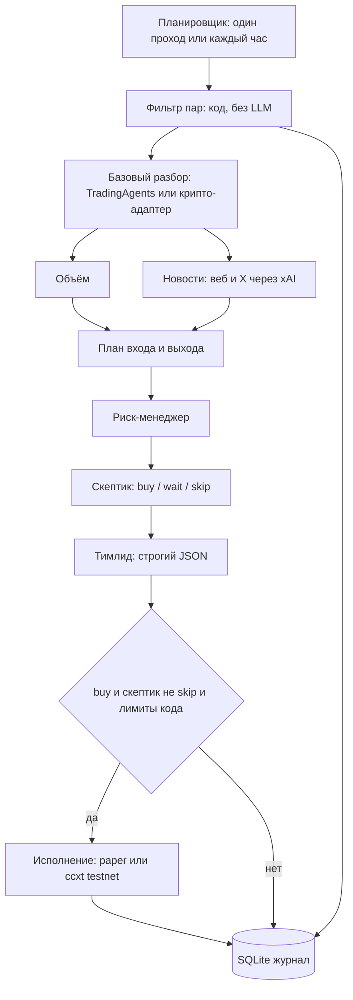

# Dexbot — мультиагентный крипто-деск (paper / testnet)

Бумажная и тестовая торговля спотом. Это исследовательский каркас, а не инвестиционная рекомендация: модели ошибаются, тестовая сеть не повторяет боевой стакан, прошлый результат ничего не гарантирует.

По умолчанию стол только считает сделки на бумаге. Testnet включается явным `mode: testnet`. Ордера на mainnet невозможны, пока в конфиге одновременно не стоят `mode: mainnet` и `allow_mainnet: true`.

## Архитектура

Раз в час (по закрытой 1h свече) проходит один конвейер:



1. **Фильтр** — обычный код. Спот, котировка USDT, топ 30–50 по обороту, минимальный суточный объём (по умолчанию 20 млн USD), спред, возраст листинга, если биржа его отдаёт, блок-лист мемкоинов и стейблкоинов, отсев плеч (`3L`/`UP`/`BULL` и т.п., при этом тикер `JUP` не считается UP).
2. **Базовый разбор.** По желанию вызывается [TauricResearch/TradingAgents](https://github.com/TauricResearch/TradingAgents): `TradingAgentsGraph.propagate(ticker, date, asset_type="crypto")`. Пока флаг выключен, работает свой крипто-аналитик с тем же контрактом отчёта: техника, сентимент, новости, структура рынка. Почему пакет не стоит в обязательных зависимостях — в разделе ниже.
3. **Второй слой, шесть агентов.** Объём (флаг считает код: отношение к медиане и z-score за 24 закрытых часа; модель только комментирует). Новости через живой поиск xAI по вебу и X, каждая новость помечается `serious news`, `minor news` или `rumor`. План: вход, стоп, тейк, только лонг. Риск-менеджер смотрит прибыль к риску. Скептик голосует `buy` / `wait` / `skip`. Тимлид отдаёт одно решение, его проверяет pydantic.
4. **Исполнение.** Сделка уходит на биржу только если тимлид сказал `buy`, скептик не сказал `skip` (голос `wait` сам по себе не вето), и все числовые лимиты прошли. Лимиты не в промпте: риск на сделку не больше 1% эквити, не больше 3 открытых позиций, дневной убыток 3%, kill switch закрывает всё. Отношение прибыль/риск считается по цене, по которой реально купим (рыночный ордер по текущей mark), и должно быть не хуже 1:2. Стоп и тейк снимает код на следующих проходах, без модели.

Журнал пишет каждого кандидата, ответ и голос каждого агента, ордера, филлы и PnL.

## Почему TradingAgents подключён адаптером

Репозиторий [TauricResearch/TradingAgents](https://github.com/TauricResearch/TradingAgents) — это LangGraph-разбор акций (есть режим `asset_type="crypto"`) со своими поставщиками данных и своим симулированным портфелем. Тащить его как единственный обязательный контур неудобно:

- тяжёлые зависимости (langchain, langgraph, yfinance, жёсткий pin pandas) и длинный цикл дебатов на каждый тикер — для 30–50 монет каждый час это другой порядок времени и денег;
- цены upstream не обязаны совпадать со стаканом Bybit или Binance, с которого мы фильтруем и куда шлём ордер;
- жёсткий риск и ccxt должны жить снаружи графа, иначе kill switch и лимит 1% можно обойти текстом модели.

Адаптер в `dexbot/base_analysis.py` при `tradingagents.enabled: true` строит конфиг провайдера `xai` с `backend_url: https://api.x.ai/v1` и вызывает `propagate`. Если пакета нет и `fallback_to_native: true`, остаётся крипто-аналитик на наших свечах. Установка опциональна:

```bash
pip install "dexbot[tradingagents]"
```

## LLM

Клиент OpenAI-совместимый. По умолчанию xAI:

- `base_url`: `https://api.x.ai/v1`
- ключ: переменная `XAI_API_KEY`
- модель на каждого агента в `config/default.yaml`. Рутинные агенты — более дешёвая модель, скептик и тимлид — более сильная. Имена моделей должны существовать на ключе; при смене линейки Grok правьте yaml, а не код.

Новости ходят в Chat Completions с телом `search_parameters`: режим `on`, источники `web` и `x`. Это живой поиск Grok, а не отдельный краулер.

Запасной OpenAI-совместимый прокси (в том числе freellmapi) включается в `llm.fallback` и разрешён только агенту `volume`. Скептик, тимлид, новости и план на fallback не уходят: конфиг с ними не загрузится. У новостей поиск есть только у основного провайдера.

## Установка

Нужен Python 3.11+.

```bash
python -m venv .venv
source .venv/bin/activate
pip install -e ".[dev]"
cp .env.example .env
```

В `.env` для боевого прогона с моделью достаточно `XAI_API_KEY`. Ключи биржи для бумаги не нужны. Файл `.env` в git не коммитится.

Проверка без сети, без ключей и без ордеров:

```bash
python -m dexbot run --once --mock
```

Ожидается строка вида `cycle run=1 mode=paper ... executed=1`. Скрипт подставляет фиктивный стакан и фиксированные ответы агентов: BTC проходит все ворота, ETH режет скептик, SOL режет отношение 1:2, DOGE и плечо отсекает фильтр.

Отчёт:

```bash
python -m dexbot report
# или
python -m dexbot.report
```

Тесты:

```bash
pytest
```

Часовой цикл (уже с живой моделью и, в paper, с публичными котировками выбранной биржи; ордера остаются бумажными):

```bash
python -m dexbot run
```

Один живой проход: `python -m dexbot run --once`.

## Конфиг

Главный файл — `config/default.yaml`. Секреты только в окружении.

| Режим | Что делает |
| --- | --- |
| `paper` (по умолчанию) | Публичные котировки без ключа, филлы в памяти и в SQLite. Ордер на биржу не уходит. |
| `testnet` | ccxt в sandbox. Bybit смотрит на testnet, Binance spot — на `testnet.binance.vision`. Если URL не тестовый, клиент отказывается слать ордер. |
| `mainnet` | Не загрузится без `allow_mainnet: true`. Дальше нужны `DEXBOT_MAINNET_API_KEY` и `DEXBOT_MAINNET_API_SECRET`. Этих переменных нет в `.env.example` специально. |

`DEXBOT_MODE` и `DEXBOT_ALLOW_MAINNET` перекрывают yaml, если заданы. Для теста удобнее не экспортировать их.

Kill switch: `risk.kill_switch: true`, флаг CLI `--kill-switch` или файл `data/KILL` (`touch data/KILL`). Позиции закрываются рыночными продажами, новые входы в этом проходе не открываются. Файл сам не удаляется.

## Testnet

Bybit spot, testnet ([testnet.bybit.com](https://testnet.bybit.com)):

```yaml
mode: testnet
exchange:
  name: bybit
```

```bash
# .env
BYBIT_TESTNET_API_KEY=...
BYBIT_TESTNET_API_SECRET=...
```

Binance spot, testnet ([testnet.binance.vision](https://testnet.binance.vision)):

```yaml
mode: testnet
exchange:
  name: binance
```

```bash
BINANCE_TESTNET_API_KEY=...
BINANCE_TESTNET_API_SECRET=...
```

Интерфейс один: `Venue` с рыночными данными и брокером. Рыночная покупка идёт объёмом в базовой монете, размер уже ужат кодом под 1% риска и под свободный USDT. Частичный или пустой филл позицию не открывает.

На testnet и котировки, и ордера идут в sandbox, чтобы цена и филл были с одной площадки. В paper котировки читаются с публичного прод-API без ключа — это не торговля на mainnet, заявок туда отправить нечем.

## Журнал

SQLite (`journal.path`, по умолчанию `data/journal.sqlite`):

- прогоны;
- кандидаты фильтра, в том числе отсеянные, с причиной;
- выход каждого агента: stance, текст, JSON;
- решение тимлида и причина отказа;
- ордера, филлы, позиции, снимок эквити.

Отчёт считает число закрытых сделок, долю прибыльных, реализованный и нереализованный PnL и полезность агента. Полезность — это доля прибыльных среди закрытых сделок, где агент сказал `buy`, минус общая доля прибыльных. По отсеянным идеям результата нет, поэтому это не «что было бы, если бы вошли».

## Деплой на Linux

### systemd

```bash
sudo useradd --system --create-home --home-dir /opt/dexbot dexbot
sudo mkdir -p /opt/dexbot
sudo rsync -a --exclude .venv --exclude data ./ /opt/dexbot/
sudo python3 -m venv /opt/dexbot/.venv
sudo /opt/dexbot/.venv/bin/pip install -e /opt/dexbot
sudo cp /opt/dexbot/.env.example /opt/dexbot/.env
sudo chown -R dexbot:dexbot /opt/dexbot
# вписать ключи в /opt/dexbot/.env и при необходимости mode: testnet в yaml
sudo cp deploy/dexbot.service /etc/systemd/system/dexbot.service
sudo systemctl daemon-reload
sudo systemctl enable --now dexbot
sudo journalctl -u dexbot -f
```

Юнит запускает `python -m dexbot run` из `/opt/dexbot` и подхватывает `.env`. Остановить входы и закрыть позиции: `sudo -u dexbot touch /opt/dexbot/data/KILL` и дождаться следующего прохода, либо `systemctl stop` после ручного `--kill-switch`, если нужно закрыть сразу:

```bash
sudo -u dexbot /opt/dexbot/.venv/bin/python -m dexbot run --once --kill-switch \
  --config /opt/dexbot/config/default.yaml
```

### Docker

Каталог `data/` должен быть доступен uid 10001, под которым работает образ.

```bash
cp .env.example .env
mkdir -p data
sudo chown 10001:10001 data
docker compose up -d --build
docker compose logs -f
```

Разовый mock внутри контейнера:

```bash
docker compose run --rm dexbot \
  python -m dexbot run --once --mock --config /app/config/default.yaml
```

Образ не включает `allow_mainnet`. Пока в примонтированном yaml стоит `mode: paper`, контейнер не шлёт ордера.

## Что сознательно не делает стол

- не шортит: только спот-лонг;
- не усредняет уже открытый символ;
- не доверяет числу риска из текста модели, если код посчитал иначе;
- не включает mainnet одной опечаткой в `mode`.
